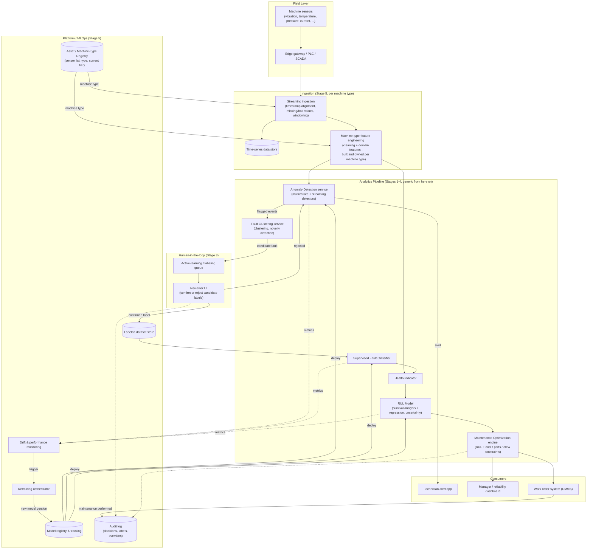
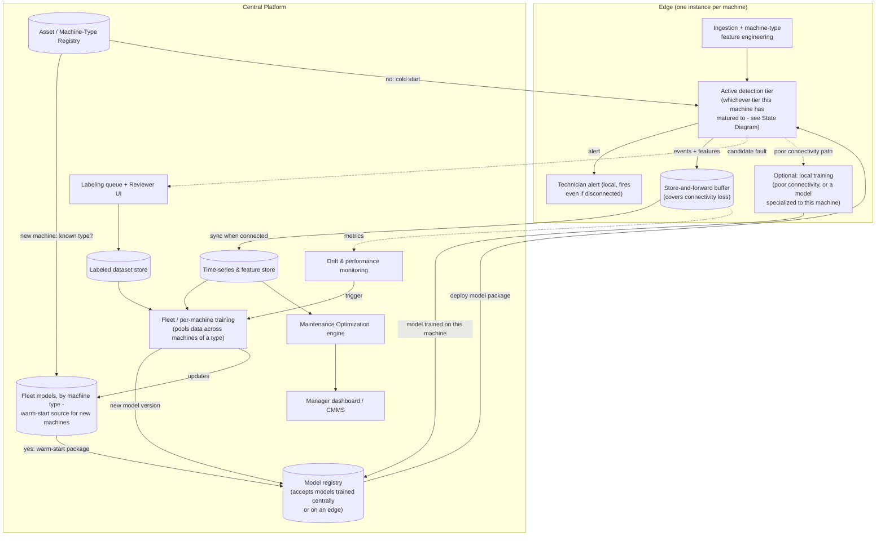

# Block Diagram — System Components

Written for: the repo owner, early design planning. See [README.md](README.md) for the stage legend
this document refers to.

This document has two diagrams: the logical components and data flow (what each piece does), and the
deployment topology (where each piece physically runs). They describe the same system from two angles.

## 1. Logical Components

Names components and their data flow, not specific libraries or vendors — the plan's stage sections list
candidate libraries for each box. **The one box in this diagram that is explicitly not generic** is
Machine-Type Feature Engineering: per the scope decision in
[Design Risks and Open Questions.md](Design%20Risks%20and%20Open%20Questions.md#1-how-broad-is-generalized-for-now),
everything to its right assumes a clean, consistent, feature-rich stream; everything to its left is where
the system has to be rebuilt per machine type.

### Component notes

| Component | Stage | Role |
|---|---|---|
| Sensors / Edge gateway | — | Physical layer; out of scope for the software system, listed for completeness. |
| Asset / Machine-Type Registry | 5 | Records each machine's type, sensor list, and current detection-maturity tier. Decides which machine-type feature-engineering pipeline and which fleet model (see topology diagram below) apply to a given machine. |
| Streaming ingestion | 5 | Aligns timestamps across sensors, handles missing or bad values, produces windows for the detectors downstream. Built per machine type, since sensor sets and sampling rates differ. |
| Time-series data store | 5 | Raw history, used for retraining, audits, and backfilling new models. |
| Machine-type feature engineering | 1 (boundary) | Time- and frequency-domain features (RMS, kurtosis, FFT bands, etc.), cleaning, and consistency checks, custom per machine type. This is the boundary where "generic" starts — everything after it assumes clean, feature-rich data. |
| Anomaly Detection service | 1 | Multivariate and streaming detectors; the system's first line of defense and the trigger for everything downstream. Generic across machine types once fed consistent features. |
| Fault Clustering service | 2 | Groups anomalies into candidate fault types without labels; flags anomalies that fit no known cluster as novel. |
| Active-learning queue / Reviewer UI | 3 | Where a person confirms or rejects a candidate label. No label reaches the classifier without going through here. |
| Supervised Fault Classifier | 3 | Matures as confirmed labels accumulate; replaces reliance on clustering alone over time. |
| Health Indicator | 4 | A degradation index built from features and classifier output, tracked over time as the input to RUL. |
| RUL Model | 4 | Survival analysis and regression, with uncertainty (quantile or conformal), consuming the health indicator. |
| Maintenance Optimization engine | 4/5 | Turns an RUL estimate plus business constraints into a recommended maintenance window. Still not detailed — see [Design Risks and Open Questions.md](Design%20Risks%20and%20Open%20Questions.md#10-maintenance-optimization-engine-internals). |
| Technician alert app | — | Consumes anomaly alerts and maintenance work orders. See [Use Cases.md](Use%20Cases.md). |
| Manager / reliability dashboard | — | Consumes RUL estimates and scheduling recommendations. |
| Work order system (CMMS) | — | Assumed external/integration-only, not something this project builds. |
| Model registry, drift monitor, retraining orchestrator | 5 | Keeps the models versioned and retrained as data and failure modes evolve. See the deployment diagram for where training actually runs. |
| Audit log | 5 | Records every human decision (label confirmation, rejection, schedule override) for traceability. |

## 2. Deployment Topology: Edge and Central

Inference always runs on the edge, next to the machine. Training usually runs centrally (pooling data
across machines) but the design has to accept a model trained on the edge too — for machines with poor
connectivity, or ones that need a model specialized to just that unit. New machines of a known type
warm-start from an existing fleet model rather than starting cold.

### Notes

- **"Active detection tier" on the edge covers all five Detection Maturity tiers**, not just anomaly
  detection — threshold checks, statistical control charts, the ML detector, the fault classifier, and
  the RUL model are all, from a deployment standpoint, just "a model package currently deployed to this
  edge." The [Detection Maturity diagram](State%20Diagram.md#1-detection-maturity) describes which one
  is active and why; this diagram only describes where it runs.
- **Cold start vs. warm start now has a concrete owner.** The Asset Registry decides, at onboarding,
  whether a fleet model exists for a new machine's declared type. If yes, the Model Registry deploys that
  fleet model's current tier directly, skipping the "point data here" cold start described in the State
  Diagram. If no, the machine starts cold, and its eventually-matured models can seed the fleet model for
  that type (`FleetTrain -- updates --> FleetModels`), so the *next* machine of a new type doesn't start
  cold either.
- **Local training is the exception, not the default.** It exists for two cases: a site with unreliable
  connectivity that cannot wait for a central round-trip, and a machine whose behavior is specialized
  enough that pooling it into the fleet model would be wrong. Either way, a locally-trained model is still
  expected to register with the central Model Registry so it is versioned and auditable, not a silent,
  untracked fork.
- **The model registry has to accept a model from either source.** This implies a portable packaging
  format regardless of where training happened — the plan already points at ONNX for edge deployment,
  which fits.

## Open questions

- Is the work order system (CMMS) something this project integrates with, or does the project need to
  build a minimal one for the generic case? Assumed external/integration-only above.
- Should the Health Indicator and RUL Model be one component or two? They are split here because the
  plan treats "build a degradation index" and "RUL regression on run-to-failure data" as separate
  techniques, but they could be merged into a single health-and-RUL service.
- See [Design Risks and Open Questions.md](Design%20Risks%20and%20Open%20Questions.md) for the
  cross-cutting risks this topology introduces (training/serving skew between edge and central feature
  computation, fleet model update cadence, and edge hardware constraints on model size).
