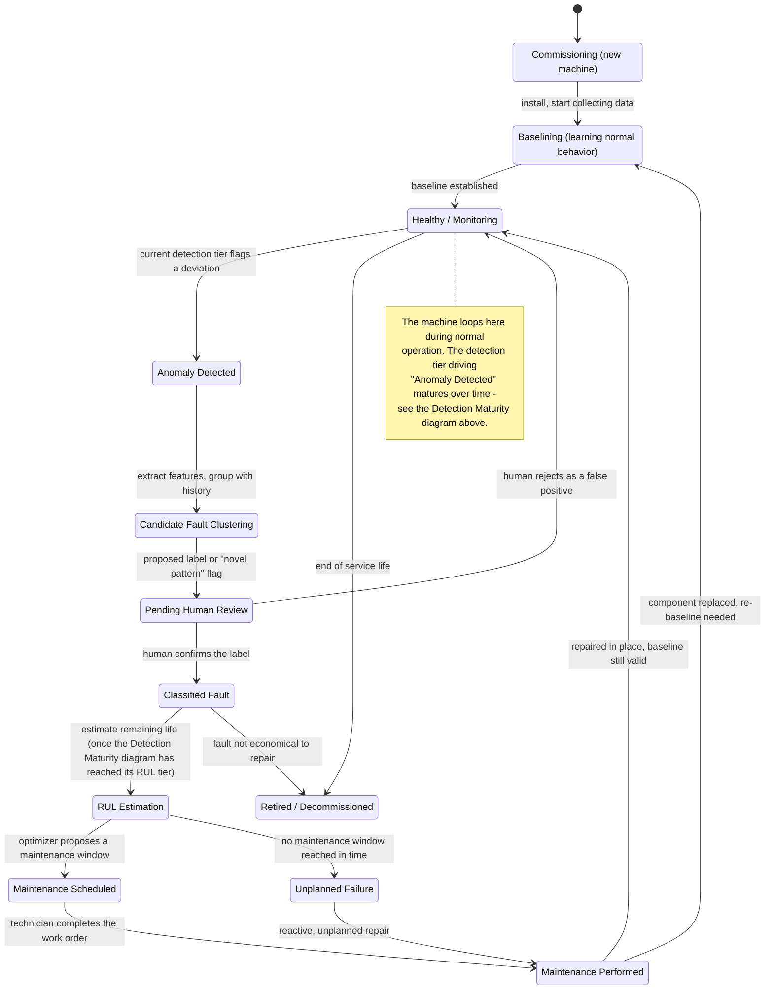

# State Diagrams

Written for: the repo owner, early design planning. See [README.md](README.md) for the stage legend
these diagrams refer to.

This document holds two state machines that answer different questions:

1. **Detection Maturity** — which detection method is currently doing the work for a given machine, and
   how that upgrades as data and failures accumulate. This is the primary diagram.
2. **Machine Operational Lifecycle** — what state a specific machine is in right now (healthy,
   under review, scheduled for maintenance, ...). Kept here because [Use Cases.md](Use%20Cases.md)
   references its state names directly.

The two are related: the Operational Lifecycle's "Anomaly Detected" transition is driven by whichever
method the Detection Maturity diagram currently has active, and its "RUL Estimation" state only becomes
reachable once Detection Maturity has reached its last tier.

## 1. Detection Maturity

A new machine starts with nothing: no baseline, no labels, no failure history. The system has to be
useful from the first data point, then get smarter as evidence accumulates. Maturity here is not
something an operator configures — it is an emergent property of how much data and how many confirmed
faults have been seen.

```mermaid
stateDiagram-v2
    [*] --> ThresholdDetection : new machine, unknown type -<br/>no fleet model exists (cold start)
    [*] --> WarmStart : new machine, known type -<br/>a fleet model already exists

    state "Threshold Detection<br/>(\"dumb\" static limits)" as ThresholdDetection
    state "Warm-Started<br/>(begins at whichever tier the<br/>fleet model for this type has<br/>already reached)" as WarmStart
    state "Statistical Anomaly Detection" as StatDetection
    state "ML Anomaly Detection" as MLDetection
    state "Semi-Supervised Classification" as SemiSupervised
    state "RUL Estimation &<br/>Maintenance Optimization" as RULOpt

    WarmStart --> StatDetection
    WarmStart --> MLDetection
    WarmStart --> SemiSupervised
    WarmStart --> RULOpt

    ThresholdDetection --> StatDetection : enough normal-operation history to fit a per-sensor baseline (Stage 1)
    StatDetection --> MLDetection : enough multivariate history collected; univariate stats plateau (Stages 1-2)
    MLDetection --> SemiSupervised : a fault occurs and a human confirms its label (Stage 3)
    SemiSupervised --> RULOpt : enough confirmed failure / run-to-failure history to fit survival and RUL models (Stage 4)

    note right of WarmStart
        Exactly one of the four outgoing
        transitions fires, chosen by the Asset
        Registry at onboarding (see the
        deployment diagram in Block Diagram.md).
        This machine still passes through
        whatever tiers remain ahead of it
        normally - warm start only skips the
        tiers the fleet has already earned.
    end note

    note right of ThresholdDetection
        Day one: no history exists yet.
        Static, operator-set limits (or
        conservative defaults) catch gross
        problems immediately while the system
        passively accumulates a history buffer
        in the background. This is the
        "point data here" entry point - zero
        configuration needed to get some
        protection on day one.
    end note

    note right of StatDetection
        z-score / IQR, EWMA, CUSUM, quantile
        thresholds, peaks-over-threshold.
        Becomes the primary detector once a
        baseline exists; static limits remain
        as a coarse fallback underneath it.
    end note

    note right of MLDetection
        Multivariate detectors (Isolation
        Forest, One-Class SVM, autoencoder
        reconstruction error) plus unsupervised
        fault clustering, once there is enough
        data and enough distinct anomalies to
        group into candidate fault types.
    end note

    note right of SemiSupervised
        Active learning plus human-confirmed
        labels. Matures from semi-supervised
        toward a fully supervised classifier
        as more confirmed labels accumulate -
        this is a gradual shift inside the
        state, not a separate tier.
    end note

    note right of RULOpt
        Needs enough failure events, including
        censored (not-yet-failed) cases, to fit
        Kaplan-Meier / Weibull / Cox models and
        an RUL regressor, then turns the
        estimate into a maintenance
        recommendation.
    end note
```

### Why each transition is gated the way it is

| Transition | What has to be true | Driven by |
|---|---|---|
| Threshold → Statistical | Enough samples of normal operation to estimate a distribution per sensor (mean/variance, quantiles). | Data volume alone. |
| Statistical → ML | Enough history across enough sensors that a multivariate model has something to learn from; univariate statistics start missing anomalies that only show up as a combination of sensors. | Data volume and variety. |
| ML → Semi-Supervised | At least one real fault has occurred, been flagged, and been confirmed by a human (see "Pending Human Review" in the lifecycle diagram below). Before this, there is nothing to classify. | A fault/failure event, not data volume. |
| Semi-Supervised → RUL & Optimization | Enough confirmed failure history (including censored, still-running cases) to fit a survival model and an RUL regressor. | Accumulated failure events over time. |

This is the heart of the maturation the plan describes: the first two transitions are paced by **how much
data exists**; the last two are paced by **how many real faults and failures have actually happened**. A
quiet, healthy machine can sit in "Statistical Anomaly Detection" for a long time — that is expected, not
a failure of the design.

### What does not happen

Earlier tiers are not discarded when a machine advances. Threshold checks and statistical control charts
keep running underneath the ML detector as a cheap sanity check; the diagram tracks which method is
*primary*, not which methods are *running*.

### Open questions

- ~~Per-machine or per-fleet?~~ **Resolved 2026-11-02:** new machines of a known type warm-start from a
  fleet model, shown above as the `WarmStart` entry path. See the deployment diagram in
  [Block Diagram.md](Block%20Diagram.md#2-deployment-topology-edge-and-central) for where that decision
  is made and the follow-on risks (fleet model update cadence, machine-type taxonomy, negative transfer)
  logged in [Design Risks and Open Questions.md](Design%20Risks%20and%20Open%20Questions.md).
- **Can a machine regress?** E.g., a sensor swap or a major operating-condition change could invalidate
  a learned baseline. Whether that forces a drop back to an earlier tier (vs. retraining in place) is
  open; it overlaps with the plan's Stage 5 concept-drift topic.

## 2. Machine Operational Lifecycle

This is the day-to-day state of one machine: what is happening to it right now, independent of which
detection tier is currently active underneath. [Use Cases.md](Use%20Cases.md) refers to the state names
below directly.



### Notes on specific transitions

- **Baselining is revisited after a component swap.** A detector trained on the old component's normal
  range may misfire against the replacement, so "Maintenance Performed → Baselining" is deliberate, not
  an oversight. "Maintenance Performed → Healthy" is the shortcut for repairs that do not change the
  component's normal operating signature.
- **"Pending Human Review" always sits between clustering and classification**, per the plan's stage 3
  decision: no label reaches the classifier without a person confirming it.
- **"ClassifiedFault → RUL" assumes the maturity diagram has reached its last tier.** Early in a
  machine's life, a classified fault may have nowhere to go yet, because there isn't enough failure
  history to fit an RUL model; in that case this transition is simply not available, and the only paths
  forward are reactive repair or retirement.
- **"Unplanned Failure" is a path, not a dead end**, covering RUL estimates that are wrong or
  maintenance windows that are missed.
- **Retirement can happen directly from "Healthy" or from "Classified Fault"**, covering both planned
  end-of-life and a fault judged not worth repairing.

### Open question

Should "Healthy / Monitoring" be split into sub-states for different operating regimes (e.g. idle vs.
load, startup vs. steady-state)? This diagram currently treats "Healthy" as a single state and leaves
regime-switching inside the active detector's design.
